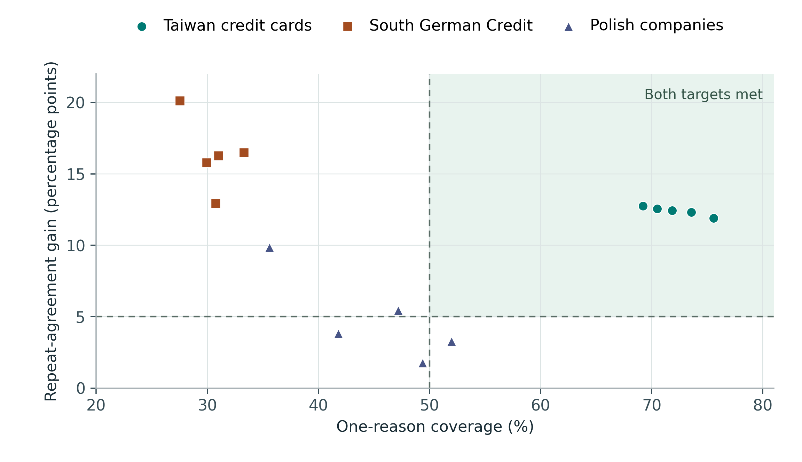
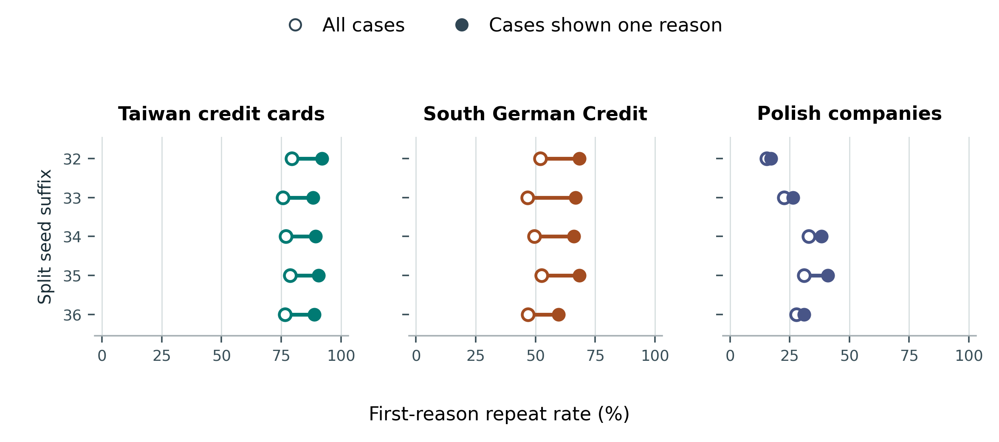

Page numbers refer to the original 24-page PDF. The italic lines tell you where to edit. Copy the text below each instruction into your report.

# Page 5 • Abstract

*Replace the last sentence, beginning “Findings are descriptive, for one dataset”, with this paragraph.*

We then applied the frozen 0.36 threshold to South German Credit and Polish Companies Bankruptcy. On all ten external splits, the first reason repeated more often in cases selected for a single reason than across all cases. The rule met its joint coverage and agreement-gain criterion on all five fresh Taiwan splits and on zero of five splits for each external dataset. These results describe explanation repeatability under logistic-regression refitting in three historical financial datasets.

# Page 6 • Introduction

*Add this bullet under “Contributions”, after the bullet about the five fresh splits.*

- An external evaluation of the frozen display rule on German consumer credit and Polish corporate bankruptcy data, measuring both how often the rule showed one reason and how often that reason repeated.

*Replace the paragraph beginning “Scope. One historical dataset”.*

**Scope.** The original audit used Taiwanese credit-card records. Two follow-up experiments tested the display rule on other financial datasets. All three used logistic regression. A first reason is the feature group with the largest contribution in absolute magnitude and can point towards higher or lower predicted risk. The audit examined model scores without applying a lending decision threshold.

# Page 7 • Dataset

*Delete the unfinished opening line ending “Regulators, auditors and”. Label the existing dataset description “Taiwan credit cards”. After “Model quality (pilot)”, add the following two paragraphs.*

**South German Credit.** The dataset contains 1,000 records, including 300 classified as bad credit. We treated bad credit as the positive outcome and excluded age, personal status/sex, and foreign-worker status. Eight categorical inputs were encoded as indicators using categories observed in the training split. We audited all 200 held-out records in each split [20].

**Polish Companies Bankruptcy.** We used the 1year.arff file, containing 7,027 company records and 271 bankruptcy labels. For group discovery, we removed inputs that were constant in the training split and filled missing values with training medians. Each model fit used its own bootstrap preprocessing. We audited 500 held-out companies per split [21].

# Pages 11 and 13 • Methods

*On page 11, replace the final sentence of “First-reason agreement”, beginning “With 500 borrowers”.*

Ten fits give 45 unordered pairs for ordinary first-reason agreement. With 500 Taiwan audit borrowers, this yields 22,500 comparisons per partition and split. The display-rule evaluation uses 90 ordered pairs because one fit chooses which reasons to show and the other supplies the comparison winner. This gives 45,000 comparisons per Taiwan split.

*On page 13, replace step 8 and add step 10 after the existing step 9.*

**8. Measure.** Compare correlation groups with 30 size-matched random partitions on overall ranking stability and individual first-reason agreement. Calculate cancellation within the six monthly Taiwan bill contributions and record the model’s predictive metrics.

**10. Test the frozen rule on external datasets.** We used five stratified 80/20 splits per dataset, with seeds 20261032 through 20261036 and ten bootstrap logistic-regression fits per split. We learned feature groups separately from each split’s training data and applied the Taiwan threshold of 0.36 without retuning. Each German split contributed 18,000 ordered comparisons and each Polish split contributed 45,000. The success criterion required a gain of at least five percentage points at one-reason coverage of at least 50% on at least four of five splits. The same records can occur in more than one split.

# Pages 15 to 18 • Existing results

*On page 15, replace the line beginning “Output. Eleven groups”.*

**Output.** The Taiwan pilot produced eleven groups. All six monthly bill amounts fell into one group, allowing us to measure how much their signed contributions offset one another.

*On page 17, replace “Clear-cut cases are reliable and close calls are not.”*

On the five exploratory Taiwan splits, larger gaps generally corresponded to higher repeat agreement. The absolute repeat rate at the frozen threshold was evaluated separately on each dataset.

*On page 18, replace the paragraph beginning “Observation: the prespecified criterion”.*

The rule met the prespecified gain and coverage targets on all five fresh Taiwan splits. Across all cases, the displayed set contained the replicate model’s first reason 85.0% of the time, compared with 80.5% when cases receiving two reasons were chosen at random and 79.7% when the leader was paired with a random second group. Among only the close calls that received two reasons, the displayed pair contained the replicate winner in 45,383 of 62,703 cases (72.4%, pooled across the five splits).

# Page 19 • New results and figures

*After the selective-reliability plot and before “3.7 Summary of findings”, insert the heading and text below. Renumber the existing summary as 3.8.*

**3.7 External evaluation of the frozen display rule**

We applied the same 0.36 threshold to each dataset. Coverage is the percentage of cases receiving one reason. The baseline repeat rate is the percentage of all cases in which the source and replicate fits agree on the first reason. The selected repeat rate uses only cases receiving one reason. Gain is the selected rate minus the baseline, calculated within each split.

| Dataset | One-reason coverage | All-case repeat rate | Selected repeat rate | Gain (percentage points) | Splits meeting both targets |
|---|---:|---:|---:|---:|---:|
| Taiwan credit cards | 69.2–75.6% | 75.7–79.4% | 88.2–92.1% | +11.9 to +12.8 | 5/5 |
| South German Credit | 27.6–33.3% | 46.7–52.5% | 59.7–68.4% | +12.9 to +20.1 | 0/5 |
| Polish companies | 35.6–52.0% | 15.3–32.9% | 17.1–40.9% | +1.8 to +9.9 | 0/5 |

*Table caption.* **Performance of the frozen rule across datasets.** Each range gives the minimum and maximum across five evaluation splits. The Taiwan row uses the five fresh splits.

All five German splits exceeded the gain target, but one-reason coverage reached at most 33.3%. In Poland, two splits met the gain target and one met the coverage target. These were different splits. Taiwan was the only dataset on which individual splits met both targets (Figure 7).

**Figure 7. Coverage and repeat-agreement gain at the frozen threshold.** Each point represents one split. The shaded region marks splits with at least 50% one-reason coverage and at least five percentage points of gain. All five fresh Taiwan splits fall inside this region.

Selected cases had higher repeat agreement on every evaluation split. Absolute agreement among selected cases nevertheless varied widely. A single displayed reason repeated in 88.2–92.1% of cases on Taiwan, 59.7–68.4% on German credit, and 17.1–40.9% on Polish companies (Figure 8).

**Figure 8. First-reason repeat agreement before and after selecting cases.** Each line connects the all-case repeat rate and the selected one-reason repeat rate on the same split. The five rows in each dataset panel use the same split seeds. Horizontal distance gives the gain in percentage points.

Against the 30 size-matched random partitions, correlation groups had higher overall ranking stability on two of five German splits and four of five Polish splits. They had higher individual first-reason agreement on two of five splits in each dataset.

*Add this row to the existing summary-of-findings table under 3.8.*

| Finding | Evidence | Interpretation |
|---|---|---|
| The frozen rule selected more repeatable cases across datasets | Positive gain on all ten external splits. Both targets met on 0/5 German and 0/5 Polish splits. | The observed gain transferred, while coverage and absolute repeatability varied by dataset. |

# Page 20 • Conclusion

*Replace “The study ran over ten train/test splits, five exploratory and five fresh.”*

The Taiwan study used five exploratory and five fresh splits. We subsequently evaluated the frozen display rule on five splits each of South German Credit and Polish Companies Bankruptcy.

*Replace the two closing paragraphs beginning “The strongest supported result” and “The work is reproducible”.*

Cases selected for a single reason had higher first-reason repeat agreement than the all-case baseline on each of the 15 evaluation splits. The frozen 0.36 rule met the joint target on all five fresh Taiwan splits. On German credit, coverage stayed below 50% despite gains of 12.9–20.1 percentage points. On Polish companies, selected repeat agreement remained below 41% on every split. A threshold that worked on the development dataset therefore needs evaluation on the intended population before its coverage or reliability can be assumed.

The repository records the Taiwan protocol, tests, and results. The German and Polish results come from follow-up runs using dataset-specific preprocessing. Each experiment uses overlapping random splits from a historical dataset and a single model family. The results describe repeatability under refitting and do not establish that a displayed reason caused an outcome.

# Page 21 • Future scope

*Replace the bullet beginning “A second dataset”.*

- **Matched-coverage comparison.** Compare the relative gap with the absolute gap and the magnitude of the leading contribution at identical one-reason coverage. Measure which score best identifies repeatable explanations on held-out data. A further dataset with comparable monthly histories would also allow a direct replication of the Taiwan bill-cancellation analysis.

# Page 24 • References

*Add these entries after reference 19.*

20. UCI Machine Learning Repository. South German Credit (UPDATE), dataset 573. [Dataset record](https://archive.ics.uci.edu/dataset/573/south+german+credit+update)

21. UCI Machine Learning Repository. Polish Companies Bankruptcy, dataset 365. The external evaluation uses the 1year.arff file. [Dataset record](https://archive.ics.uci.edu/dataset/365/polish+companies+bankruptcy+data)
